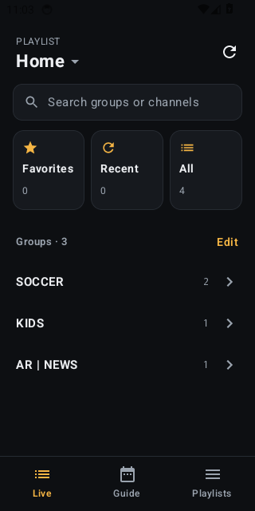
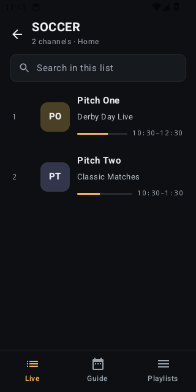
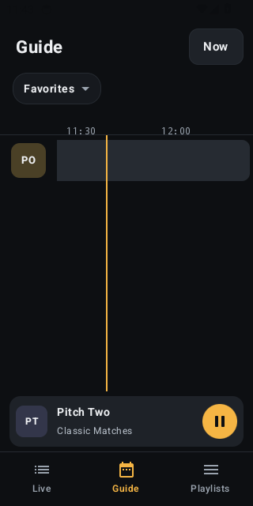
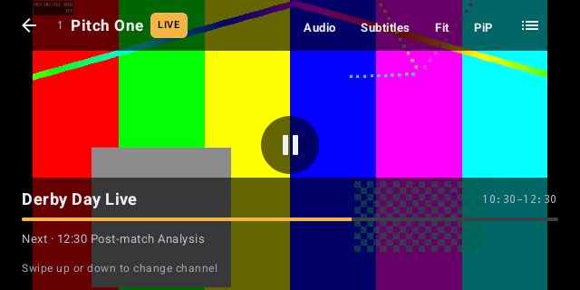

# IPTV Player

A small, fast IPTV player for Android phones. It supports **Xtream Codes** logins and **M3U** playlists, with a TV guide (EPG), several subscriptions at once, and Dolby Digital audio.

The app has no ads, no accounts and no tracking. It doesn't include any channels: you bring your own subscription from your IPTV provider.

| Groups | Channels | Guide | Player |
|---|---|---|---|
|  |  |  |  |

*These screenshots are taken automatically by the test suite on every build, using a fake test provider.*

## Features

- **Xtream Codes and M3U.** Log in with a server, username and password, or paste an M3U link or pick an M3U file. If an M3U link contains a username and password, it's converted to an Xtream login automatically.
- **Multiple playlists.** Add as many subscriptions as you like and switch between them from the top of the Live screen.
- **Your provider's groups.** Channels are organized the way your provider organizes them, such as *SOCCER*, *KIDS* or *AR | NEWS*. You can hide groups you never watch.
- **TV guide.** The app shows what's on now on every channel, plus a scrollable guide grid. For Xtream, the guide is loaded automatically. Large and gzipped (`.xml.gz`) guides work fine.
- **Catch-up.** On Xtream channels that support it, you can watch a program from the start or replay one that already aired.
- **Favorites and Recent.** Long-press a channel to add it to Favorites. Channels you watched recently are listed under Recent.
- **Player.** Swipe up or down to change channels, and open a quick channel list without leaving the video. You can choose audio and subtitle tracks, switch between Fit, Zoom and Stretch, and use picture-in-picture. If a stream drops, the app reconnects on its own.
- **Cast to your TV.** Send the channel you're watching to a Chromecast or any TV with Google Cast built in (Android TV / Google TV, Nvidia Shield, many Sony, TCL and Hisense TVs). If the TV can't load a channel directly, the app sends it through your phone instead.
- **Open in another player.** Hand the channel to VLC, MX Player or any other video app installed on your phone.
- **Dolby Digital (AC3 / E-AC3) and DTS audio.** The app includes its own decoder for these, so channels with surround sound still have audio on phones that can't decode it themselves.
- **Light and quick.** The app is written in Kotlin and uses the phone's hardware video decoder. Channels and the guide are cached on the phone, so the app opens instantly.

## Install on your phone

You need an Android phone running **Android 8.0 or newer** with a **64-bit** processor. That covers nearly every phone from the last several years.

1. On your phone, open the **[latest release](../../releases/latest)** page.
2. Under **Assets**, tap the file named `IPTV-Player-1.0.xx.apk` to download it.
3. Open the downloaded file. The notification works, or you can find it in your Files app.
4. If Android says *"For your security, your phone is not allowed to install unknown apps from this source"*, tap **Settings**, turn on **Allow from this source**, then go back and tap **Install**.
5. If Google Play Protect warns that it doesn't recognize the app, tap **More details → Install anyway**. The warning appears because the app isn't distributed through the Play Store.
6. Open **IPTV Player**.

**Updating:** download the newer APK from the releases page and install it the same way. It installs over the old version and keeps your playlists, favorites and settings.

> **vivo / OriginOS, Xiaomi, OPPO and other phones with strict battery management:** the app refreshes channels and the guide whenever you open it, so it doesn't need to run in the background. If picture-in-picture stops when you switch apps, allow the app to run in the background in your phone's battery settings.

## Getting started

Open the app and tap **Add playlist**.

**Xtream Codes** (the most common login): enter the **server URL** your provider gave you (for example `http://example.com:8080`), plus your **username** and **password**. The channels and guide load in a few seconds.

**M3U:** switch to the **M3U** tab and paste your playlist link, or tap **Pick a file** to choose a `.m3u` file on your phone. If your provider gave you a separate guide link (XMLTV, often ending in `.xml` or `.xml.gz`), paste it into the **EPG** field. Many M3U playlists already include one, and the app picks it up automatically.

Tip: if you have both an M3U link and an Xtream login from the same provider, use Xtream. It's faster, and it supports catch-up.

## Using the app

| Where | What you can do |
|---|---|
| **Live** | Pick a group, then a channel. Favorites, Recent and All are at the top. Search finds groups and channels. **Edit** hides or shows groups. The ⟳ button reloads the playlist. |
| **Channel list** | Tap to play. **Long-press** to add or remove a favorite. |
| **Guide** | Drag sideways to move through time. **Now** jumps back to the current time. Tap a program to see its details, watch the channel, or use catch-up if it's available. |
| **Player** | Tap to show or hide the controls, double-tap to pause, and **swipe up or down to change channels**. The top bar has Audio, Subtitles, the picture size, **Cast** and the channel list. **⋮** has picture-in-picture and **Open in another app** (VLC and others). |
| **Playlists** | Tap a playlist to switch to it. Use **⋮** to refresh, edit or delete it. |

## Troubleshooting

- **A channel buffers a lot or won't start:** edit the playlist and set **Stream format** to **HLS (.m3u8)**. Some providers stream more reliably that way.
- **"The provider refused this stream":** most subscriptions only allow one or two streams at once. Close the app on your other devices and try again.
- **No guide for some channels:** the provider's guide doesn't list those channels. The app also matches channels by name, but some still won't have guide data.
- **Login failed:** check the server URL, including `http://` and the port, and your username and password. Many providers lock the account after an expiry date, which the Playlists screen shows.
- **Cast doesn't find your TV:** the phone and the TV have to be on the same Wi-Fi network (not a guest network). On some routers, turn off "AP isolation" or "client isolation".
- **A channel won't play on the TV:** the app first asks the TV to play the provider's HLS stream, then tries again through your phone. If it still fails, the provider doesn't offer that channel in a format TVs can cast. Use **⋮ → Open in another app** or play it on the phone.
- **Casting stops when the phone sleeps:** this only happens for channels sent through the phone. Keep the app allowed to run in the background in your battery settings.

## Privacy

Your playlists, logins, favorites and guide data are stored only on your phone. The app talks only to the servers in your playlist. It has no analytics, no ads and no account.

## Building from source

This is a standard Android Gradle project: Kotlin, Jetpack Compose, Media3 ExoPlayer and SQLite.

```bash
# needs JDK 17, Gradle 8.11 and the Android SDK (compile SDK 35)
base64 -d app/release.keystore.b64 > app/release.keystore
gradle :app:testDebugUnitTest      # parser unit tests
gradle :app:assembleRelease        # app/build/outputs/apk/release/app-release.apk
```

Every push to `main` runs [`.github/workflows/build.yml`](.github/workflows/build.yml). That workflow:

1. checks that no code needs a newer Android version than 8.0, then runs the unit tests for the M3U, XMLTV and Xtream parsers and the Cast relay;
2. builds the release APK, shrunk with R8 and containing arm64 code only;
3. starts an Android emulator and runs an **end-to-end test** ([`EndToEndTest.kt`](app/src/androidTest/java/dev/ahmed/iptv/EndToEndTest.kt)) against a fake provider. The test adds an Xtream playlist, checks the groups, channels and guide, plays a stream with H.264 video and AC3 audio, changes channels, hands the stream to another player app, opens the Cast picker, and adds an M3U playlist;
4. publishes the APK as a GitHub release if everything passed.

The signing key is kept in the repository on purpose, so that anyone can rebuild an identical, updatable app. If you fork this project to distribute it yourself, generate your own key.

## Disclaimer

This app is a player only. It doesn't come with any channels or content. Use it only with IPTV services that you're legally entitled to watch.
